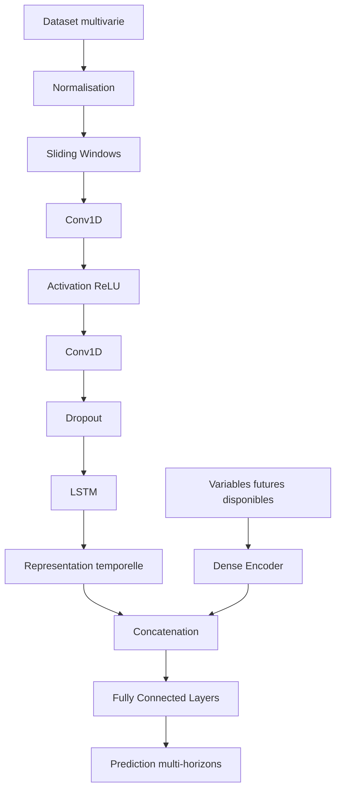

# Proposition technique — CNN 1D + LSTM

## Objectif

Explorer une architecture Deep Learning combinant
deux types de réseaux de neurones étudiés en formation :

- Convolutional Neural Network (CNN).
- Long Short-Term Memory (LSTM).

L'idée est d'aborder notre problématique comme
un problème de traitement de signaux temporels
multivariés.

## Pourquoi utiliser un CNN ?

Les CNN sont principalement connus pour leurs
applications en traitement d'image.

Cependant, il est également possible d'utiliser
des convolutions à une dimension (Conv1D)
pour traiter des signaux temporels.

En traitement du signal classique, les coefficients
des filtres sont généralement définis manuellement.

Dans un CNN, ces coefficients sont directement
appris pendant l'entraînement par backpropagation.

Le réseau peut ainsi apprendre automatiquement
à extraire des caractéristiques pertinentes :

- Variations rapides.
- Gradients.
- Motifs locaux.
- Structures périodiques.
- Interactions entre différents canaux.

L'intérêt principal est de réduire la dépendance
au feature engineering manuel.

## CNN 1D et CNN 2D

| CNN 2D | CNN 1D |
|---|---|
| Traitement d'images | Traitement de signaux |
| Convolution spatiale | Convolution temporelle |
| Pixels | Échantillons temporels |
| Motifs visuels | Motifs temporels |
| Canaux RGB | Variables multivariées |

Dans notre cas, chaque variable pourrait être
considérée comme un canal d'entrée du réseau.

Les convolutions seraient appliquées le long
de l'axe temporel.

## Pourquoi utiliser un LSTM ?

Le LSTM est une architecture de réseau de neurones
récurrent conçue pour traiter des séquences.

Contrairement à un réseau Dense classique,
il possède des mécanismes de mémoire lui permettant
de conserver certaines informations issues
des observations précédentes.

Il repose notamment sur :

- Input Gate.
- Forget Gate.
- Output Gate.
- Cell State.
- Hidden State.

Ces mécanismes permettent d'apprendre des dépendances
temporelles et de limiter certains problèmes
rencontrés avec les RNN classiques.

## Pourquoi combiner CNN et LSTM ?

Les deux architectures possèdent des fonctions
complémentaires.

Le CNN intervient comme un extracteur automatique
de caractéristiques.

Le LSTM intervient comme un modèle capable
d'apprendre l'évolution temporelle de ces
caractéristiques.

Cette combinaison permettrait donc de séparer :

- L'extraction des informations locales du signal.
- L'apprentissage de leur dynamique temporelle.

Contrairement à XGBoost, une partie importante
du feature engineering serait directement
réalisée par le réseau de neurones.

## Architecture proposée

## Préparation des données

Contrairement aux modèles Machine Learning classiques,
les données ne seraient pas uniquement représentées
sous forme de lignes indépendantes.

Nous construirions des fenêtres temporelles
successives avec la méthode Sliding Window.

Exemple de configuration initiale :

| Paramètre | Proposition |
|---|---|
| Fréquence | Horaire |
| Fenêtre historique | 168 observations |
| Horizon de prédiction | 24 observations |
| Nombre de canaux | Selon les variables disponibles |
| Type de prédiction | Multi-output |

Ces paramètres devront être ajustés en fonction
de l'analyse des signaux et du volume de données.

## Prédiction multi-horizons

Deux stratégies seraient envisageables.

### Prédiction récursive

Le réseau prédit une première valeur.

Cette prédiction est ensuite réinjectée dans le réseau
pour générer la prédiction suivante.

L'inconvénient est le risque de propagation
et d'accumulation des erreurs.

### Prédiction directe

Le réseau produit directement l'ensemble
des valeurs futures.

Cette approche serait privilégiée initialement
afin d'éviter la réinjection des prédictions.

## Configuration initiale du réseau

| Composant | Proposition |
|---|---|
| Framework | PyTorch |
| Feature extraction | Conv1D |
| Activation | ReLU |
| Temporal modeling | LSTM |
| Output | Fully Connected Layers |
| Optimizer | Adam |
| Loss function | Huber Loss ou MSE |
| Regularization | Dropout |
| Training control | Early Stopping |
| Data loading | Dataset / DataLoader |

L'objectif serait de commencer avec une architecture
relativement simple avant d'augmenter sa complexité.

## Stratégie d'entraînement

1. Synchroniser les séries temporelles.
2. Définir les périodes de train, validation et test.
3. Construire les fenêtres temporelles.
4. Normaliser les données à partir du train uniquement.
5. Construire un Dataset PyTorch.
6. Utiliser un DataLoader pour créer les batches.
7. Entraîner le réseau par backpropagation.
8. Suivre les courbes de training et validation loss.
9. Appliquer un Early Stopping.
10. Sauvegarder les meilleurs poids.
11. Évaluer le modèle sur un test indépendant.

Les cibles des différentes partitions temporelles
ne devront pas se chevaucher.

## Alternative : Temporal Convolutional Network

Une alternative intéressante serait le TCN.

Cette architecture repose sur des convolutions
temporelles causales et dilatées.

Les convolutions dilatées permettent d'augmenter
le champ réceptif du réseau sans augmenter
proportionnellement le nombre de paramètres.

Les convolutions causales permettent de respecter
l'ordre temporel des observations.

Le TCN permettrait donc de modéliser des dépendances
temporelles sans utiliser de réseau récurrent.

Il pourrait être intéressant de comparer :

- CNN 1D seul.
- LSTM seul.
- CNN + LSTM.
- TCN.

Cela permettrait de mesurer l'apport réel
de chaque composant architectural.

## Avantages

- Extraction automatique des features.
- Apprentissage des coefficients de convolution.
- Exploitation native des séquences temporelles.
- Apprentissage des dépendances à long terme.
- Réduction du feature engineering manuel.
- Architecture multivariée.
- Prédiction directe multi-horizons.

## Limitations

- Besoin potentiel de davantage de données.
- Risque de surapprentissage.
- Coût d'entraînement supérieur.
- Optimisation plus complexe.
- Interprétabilité plus difficile.
- Forte corrélation entre les fenêtres successives.

## Stack technique

| Technologie | Utilisation |
|---|---|
| Pandas | Préparation des séries temporelles |
| NumPy | Manipulation des données |
| SciPy | Traitement du signal |
| Scikit-learn | Normalisation et métriques |
| PyTorch | Construction et entraînement |
| MLflow | Suivi des expérimentations |
| Matplotlib | Analyse des courbes d'apprentissage |

## Critère de validation

L'objectif sera de déterminer si l'extraction
automatique des caractéristiques et la mémoire
temporelle apportent un gain significatif
par rapport aux modèles Machine Learning.

## Documentation technique

- https://pytorch.org/docs/stable/
- https://pytorch.org/docs/stable/generated/torch.nn.Conv1d.html
- https://pytorch.org/docs/stable/generated/torch.nn.LSTM.html
- https://arxiv.org/abs/1803.01271
