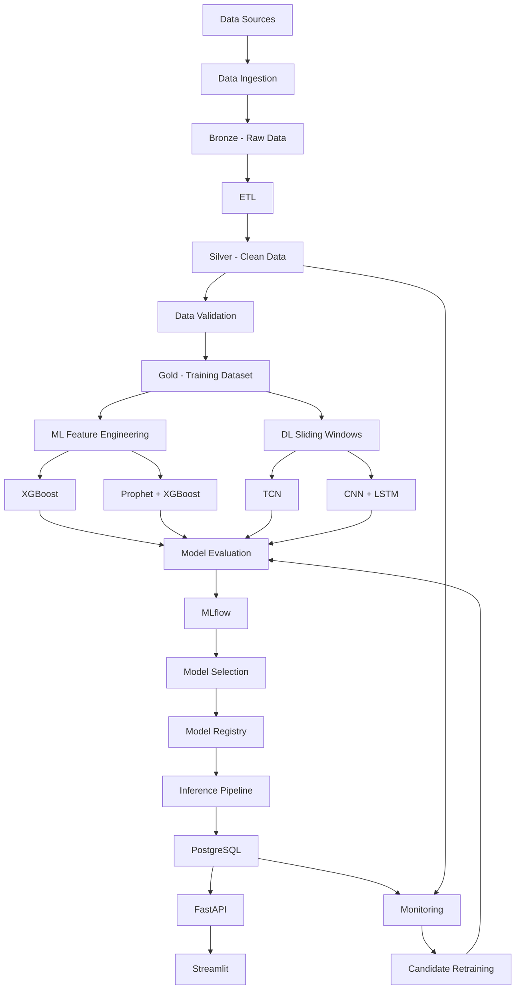
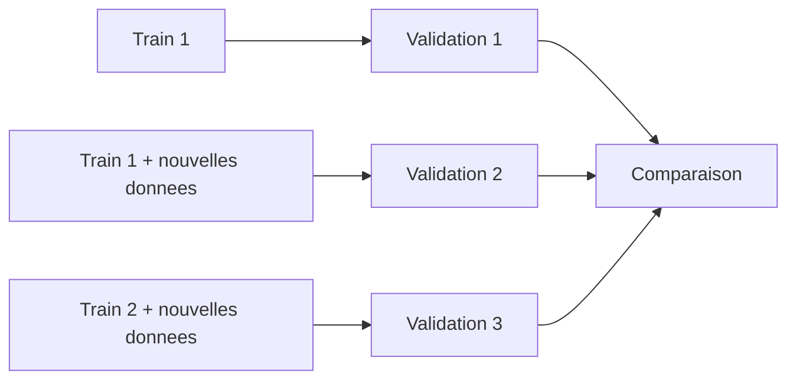
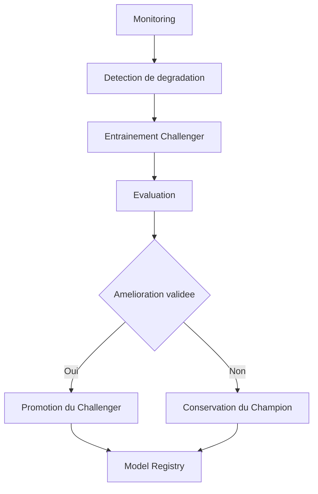

# Technical Architecture and Model Benchmark

## Objectif

Mettre en place une architecture technique commune
permettant de développer, comparer, déployer
et maintenir plusieurs modèles prédictifs.

Le choix final du modèle devra reposer sur
des résultats expérimentaux et non uniquement
sur sa complexité architecturale.

## 1. Architectures candidates

| Modèle | Catégorie | Approche |
|---|---|---|
| XGBoost | ML | Feature Engineering |
| Prophet + XGBoost | ML hybride | Residual Learning |
| TCN | Deep Learning | Temporal Convolution |
| CNN + LSTM | Deep Learning | Convolution + Recurrence |

Documentation :

- [Prophet + XGBoost](prophet_xgboost.md)
- [CNN + LSTM](cnn_lstm.md)

## 2. Comparaison des choix techniques

| Critère | XGBoost | Prophet + XGB | TCN | CNN-LSTM |
|---|---|---|---|---|
| Feature Engineering | Manuel | Manuel | Appris | Appris |
| Temporalité | Features | Décomposition | Convolution | Récurrence |
| Entraînement CPU | Adapté | Adapté | Possible | Possible |
| Accélération GPU | Possible | Partielle | Adaptée | Adaptée |
| Complexité | Faible | Moyenne | Moyenne | Élevée |
| Interprétabilité | Bonne | Bonne | Limitée | Limitée |
| Maintenance | Simple | Deux modèles | Un réseau | Un réseau |

Cette comparaison est qualitative et devra
être confirmée expérimentalement.

## 3. Analyse préalable des signaux

Avant de sélectionner les architectures,
plusieurs méthodes pourraient être utilisées
pour caractériser les séries temporelles.

| Méthode | Objectif technique |
|---|---|
| FFT | Identifier les fréquences dominantes |
| PSD / Welch | Analyser le contenu fréquentiel |
| ACF | Identifier les dépendances temporelles |
| PACF | Orienter la sélection des lags |
| Cross-correlation | Explorer les décalages temporels |
| STL | Décomposer les séries temporelles |
| Rolling statistics | Caractériser la dynamique |

Ces analyses permettraient notamment de dimensionner :

- Les lag features.
- Les fenêtres glissantes.
- Les fenêtres d'entrée des réseaux.
- Les champs réceptifs des convolutions.
- Les saisonnalités de Prophet.

Les analyses servant à sélectionner les modèles
devront être réalisées sur les données d'entraînement.

## 4. Architecture générale

## 5. Data Engineering

Une architecture Medallion simplifiée permettrait
de séparer les différentes étapes de traitement.

### Bronze

Conservation des données brutes.

- AWS S3.
- JSON ou fichiers sources.
- Horodatage des extractions.
- Traçabilité.
- Possibilité de rejouer le pipeline.

### Silver

Données nettoyées et standardisées.

- Validation des schémas.
- Gestion des valeurs manquantes.
- Gestion des doublons.
- Synchronisation temporelle.
- Standardisation.
- Stockage Parquet.

### Gold

Datasets directement exploitables par les modèles.

- Feature Engineering pour le Machine Learning.
- Sliding Windows pour le Deep Learning.
- Construction des targets.
- Versioning des datasets.
- Séparation chronologique.

## 6. Validation temporelle

Un split aléatoire classique ne serait pas adapté
à notre problématique.

Nous utiliserions une validation Walk-Forward
permettant de reproduire plusieurs situations
successives de prédiction.

Tous les modèles devront utiliser :

- Les mêmes périodes de validation.
- Les mêmes informations disponibles.
- Les mêmes horizons de prédiction.
- Les mêmes métriques.
- Un test final indépendant.

Les transformations et les normalisations devront
être ajustées sur le train uniquement.

## 7. Benchmark

Il serait intéressant de comparer les architectures
hybrides à des modèles plus simples.

| ID | Modèle | Objectif |
|---|---|---|
| B01 | Persistence | Baseline minimale |
| B02 | Prophet | Référence statistique |
| B03 | XGBoost | Référence ML |
| B04 | LSTM | Référence récurrente |
| B05 | CNN 1D | Référence convolutionnelle |
| ML01 | Prophet + XGBoost | Residual Learning |
| DL01 | CNN + LSTM | Architecture hybride |
| DL02 | TCN | Alternative convolutionnelle |

L'objectif est de mesurer l'apport réel
de chaque composant.

## 8. Métriques de comparaison

| Métrique | Utilisation |
|---|---|
| MAE | Erreur absolue moyenne |
| RMSE | Pénalisation des erreurs importantes |
| Bias | Erreur systématique |
| Skill Score | Gain par rapport à la baseline |
| Training Time | Coût d'entraînement |
| Inference Time | Coût de prédiction |
| Model Size | Taille du modèle |
| RAM / VRAM | Consommation mémoire |

La sélection devra également prendre en compte
la stabilité des performances dans le temps.

## 9. Experiment Tracking

MLflow permettrait de centraliser les expérimentations.

Pour chaque entraînement, nous pourrions enregistrer :

- Architecture utilisée.
- Hyperparamètres.
- Version du dataset.
- Version du code.
- Random seed.
- Métriques.
- Temps d'entraînement.
- Artefacts du modèle.
- Courbes d'apprentissage.

Cela permettrait de garantir la reproductibilité
des expérimentations et de comparer les résultats.

## 10. Organisation du pipeline

Quatre pipelines indépendants seraient envisagés.

| Pipeline | Fonction |
|---|---|
| Ingestion | Acquisition et validation des données |
| Training | Entraînement et évaluation |
| Inference | Génération des prédictions |
| Monitoring | Suivi des performances |

Cette séparation permettrait de modifier
ou remplacer un modèle sans reconstruire
l'intégralité du système.

## 11. Choix d'industrialisation

| Technologie | Justification |
|---|---|
| Python | Écosystème Data et ML |
| Pandas / NumPy | Manipulation des données |
| SciPy | Traitement du signal |
| Scikit-learn | Préprocessing et validation |
| PyTorch | Flexibilité des architectures DL |
| AWS S3 | Stockage des données et artefacts |
| Parquet | Stockage analytique efficace |
| PostgreSQL | Stockage structuré des résultats |
| MLflow | Tracking et versioning des modèles |
| FastAPI | Exposition des prédictions |
| Streamlit | Développement rapide du frontend |
| Docker | Reproductibilité des environnements |
| AWS EC2 | Hébergement des services |
| Terraform | Infrastructure as Code |
| GitHub Actions | Tests et déploiement automatisés |
| Pytest | Tests unitaires et d'intégration |

## 12. Monitoring

Le monitoring permettrait de suivre :

### Data Monitoring

- Disponibilité des données.
- Valeurs manquantes.
- Respect des schémas.
- Fraîcheur des données.
- Data Drift.

### Model Monitoring

- Évolution des erreurs.
- Biais de prédiction.
- Performances par horizon.
- Dégradation des performances.
- Concept Drift potentiel.

### Infrastructure Monitoring

- Temps de réponse.
- Erreurs API.
- Consommation mémoire.
- Consommation CPU.
- Échecs des pipelines.

## 13. Réentraînement

Une stratégie Champion-Challenger pourrait
être envisagée.

Le Champion correspond au modèle actuellement
utilisé en production.

Le Challenger correspond à un nouveau modèle
entraîné avec des données plus récentes.

Le Challenger ne serait déployé que si ses
performances répondent aux critères de validation.

## 14. Priorités de développement

### MVP

- Pipeline de données commun.
- Baseline.
- XGBoost.
- Validation temporelle.
- Experiment Tracking.
- Déploiement.
- Monitoring minimal.

### Recherche et optimisation

- Prophet + XGBoost.
- CNN + LSTM.
- TCN.
- Comparaison des architectures.
- Optimisation des hyperparamètres.

### Extensions

- Détection automatique du drift.
- Réentraînement automatisé.
- Champion-Challenger.
- Intervalles de prédiction.
- Explicabilité avancée.

## Conclusion

L'objectif est de construire une architecture
modulaire, reproductible et maintenable.

Les modèles doivent rester interchangeables
au sein d'un pipeline commun.

La sélection finale devra reposer sur un compromis
entre performance, robustesse temporelle,
coût de calcul et maintenabilité.
