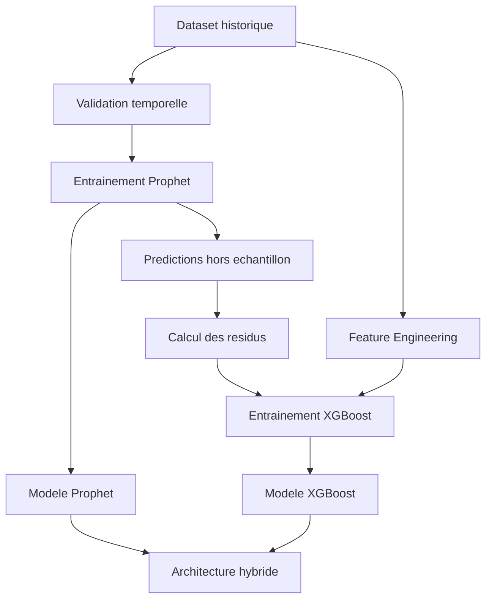
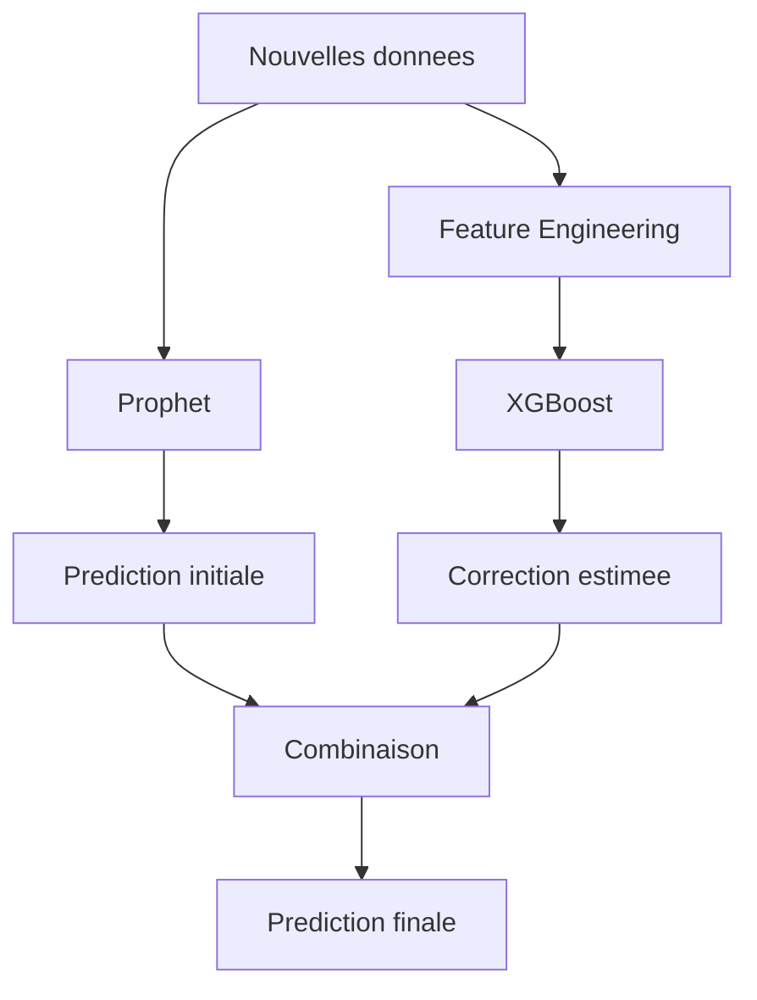

# Proposition technique — Prophet + XGBoost

## Objectif

Explorer une architecture hybride combinant deux modèles
étudiés pendant la formation : Prophet et XGBoost.

L'intérêt est de combiner deux approches complémentaires :

- La modélisation statistique des séries temporelles.
- L'apprentissage de relations non linéaires.

Cette approche est appelée Hybrid Residual Learning.

## Pourquoi Prophet ?

Prophet est un modèle spécifiquement conçu pour
la prédiction de séries temporelles.

Il permet de modéliser automatiquement :

- Les tendances.
- Les saisonnalités.
- Les changements de tendance.
- Les événements calendaires.

Son principal intérêt est de fournir une première
prédiction basée sur la structure temporelle du signal,
sans nécessiter un feature engineering trop important.

Il constitue également un modèle relativement simple
à mettre en place et à interpréter.

## Pourquoi XGBoost ?

XGBoost repose sur le Gradient Boosting, une méthode
d'ensemble utilisant plusieurs arbres de décision.

Chaque nouvel arbre cherche à améliorer les résultats
de l'ensemble des arbres précédents.

Ses principaux avantages sont :

- L'apprentissage de relations non linéaires.
- La prise en compte des interactions entre variables.
- De bonnes performances sur les données tabulaires.
- La gestion native de certaines valeurs manquantes.
- Un coût d'entraînement relativement faible.
- L'optimisation des hyperparamètres.
- L'interprétation des résultats avec SHAP.

Contrairement à Prophet, XGBoost ne possède pas
de structure temporelle native.

Il est donc nécessaire de construire des features
permettant de représenter cette temporalité.

## Pourquoi combiner les deux modèles ?

L'idée serait d'utiliser Prophet pour apprendre
la structure temporelle générale du signal.

XGBoost interviendrait ensuite pour apprendre
les erreurs de prédiction de Prophet.

Ces erreurs sont appelées résidus.

Plutôt que d'entraîner deux modèles indépendants
et de moyenner leurs prédictions, nous utiliserions
XGBoost comme un modèle de correction.

La prédiction finale correspondrait à la prédiction
de Prophet corrigée par XGBoost.

## Architecture d'entraînement

## Architecture d'inférence

## Feature Engineering

Pour intégrer la dimension temporelle dans XGBoost,
plusieurs techniques pourraient être utilisées.

| Technique | Objectif |
|---|---|
| Lag features | Exploiter les observations précédentes |
| Rolling mean | Représenter les tendances locales |
| Rolling standard deviation | Représenter la variabilité |
| Exponential moving average | Pondérer les observations récentes |
| Gradients | Représenter la dynamique du signal |
| Calendar features | Représenter les cycles temporels |
| Fourier features | Représenter les périodicités |
| Forecast horizon | Identifier l'échéance de prédiction |

Une analyse préalable des séries temporelles
permettrait de sélectionner les features pertinentes.

## Stratégie d'entraînement

1. Construire un dataset chronologique.
2. Séparer les données d'entraînement et de validation.
3. Entraîner Prophet sur plusieurs fenêtres temporelles.
4. Générer des prédictions hors échantillon.
5. Calculer les résidus associés.
6. Construire les features de XGBoost.
7. Entraîner XGBoost sur les résidus.
8. Combiner les deux modèles.
9. Optimiser les hyperparamètres sur la validation.
10. Évaluer l'architecture sur un test indépendant.

## Validation et data leakage

Les résidus utilisés pour entraîner XGBoost
ne doivent pas être calculés à partir des prédictions
de Prophet sur ses propres données d'entraînement.

Il faudra utiliser une validation temporelle
de type Walk-Forward.

Toutes les features devront également être construites
à partir des informations réellement disponibles
au moment de la prédiction.

## Avantages

- Réutilisation de modèles étudiés en formation.
- Complémentarité des architectures.
- Modélisation explicite de la temporalité.
- Apprentissage des relations non linéaires.
- Interprétation relativement accessible.
- Entraînement possible sur CPU.
- Architecture modulaire.

## Limitations

- Deux modèles à entraîner et à maintenir.
- Feature engineering nécessaire.
- Backtesting Prophet potentiellement coûteux.
- Risque de data leakage.
- Gain de performance non garanti.

## Stack technique

| Technologie | Utilisation |
|---|---|
| Pandas | Préparation des datasets |
| NumPy | Calcul numérique |
| SciPy | Analyse des signaux |
| Statsmodels | Analyse des séries temporelles |
| Prophet | Modélisation temporelle |
| XGBoost | Apprentissage des résidus |
| Scikit-learn | Validation et optimisation |
| SHAP | Interprétation de XGBoost |
| MLflow | Suivi des expérimentations |

## Critère de validation

Cette architecture devra être comparée à Prophet seul
et XGBoost seul afin de mesurer objectivement
l'intérêt de leur combinaison.

## Documentation technique

- https://facebook.github.io/prophet/
- https://xgboost.readthedocs.io/
- https://scikit-learn.org/
- https://shap.readthedocs.io/
