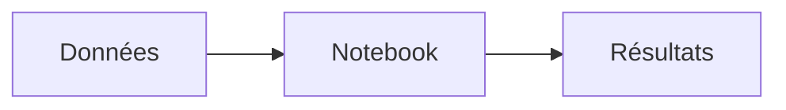

---
search:
  exclude: true
---

# Zensical Documentation

- [Documentation Zensical](https://zensical.org/docs/)
- [Syntaxe Markdown](https://zensical.org/docs/authoring/)
- [Blocs de code et annotations](https://zensical.org/docs/authoring/code-blocks/)
- [Onglets](https://zensical.org/docs/authoring/content-tabs/)
- [Admonitions](https://zensical.org/docs/authoring/admonitions/)
- [Diagrammes](https://zensical.org/docs/authoring/diagrams/)

# Main Section

## Subsection

### Codeblocs

=== "Python"

    ```python title="example.py"
    pollutants = ["NO2", "PM2.5"]  # (1)!
    for pollutant in pollutants:
        print(pollutant)  # (2)!
    ```

    1. Une liste de **polluants**.
    2. Une annotation avec du `code` et un [lien](data.md).

=== "YAML"

    ```yaml
    dataset:
      source: geodair # (1)!
      department: "75" # (2)!
    ```

    1. Source des données.
    2. Département de Paris.


## Admonitions

!!! note
    Une note

!!! tip "tips"
    **gras**, *italique*, `code`

!!! info
    Une information

!!! warning
    Un point d'attention

??? note "repliables"
    Un complément accessible au clic.

## Table

| Source | Période | Qualité |
| --- | --- | --- |
| Geod'air | À compléter | À compléter |
| ERA5 | À compléter | À compléter |

## Diagrams



### Footnotes

[^1]: This is a footnote content.